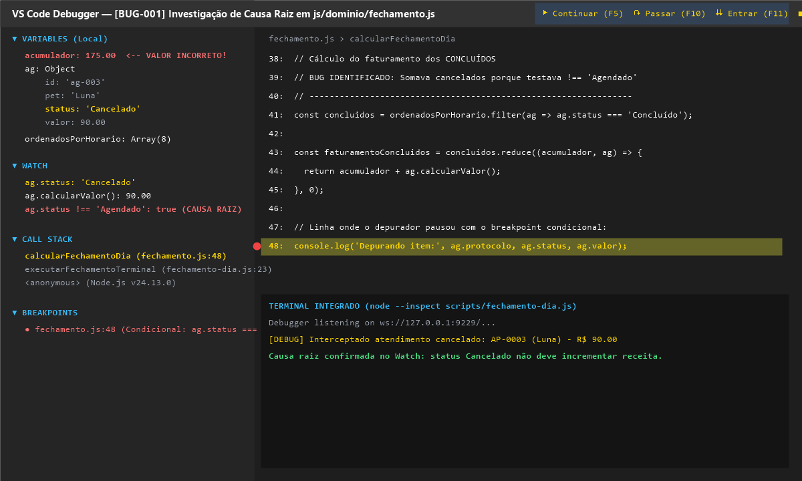
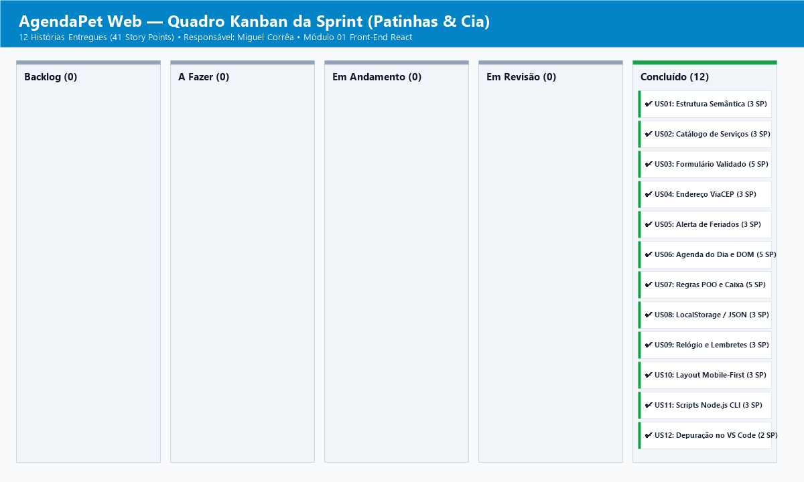

Descricao das Alteracoes

Neste Pull Request eu finalizei a construcao da agenda do dia e as regras de negocio do AgendaPet para a Patinhas e Cia. O foco foi deixar o atendimento da bancada fluido, com calculo automatico de precos, bloqueio de horarios duplicados e fechamento de caixa confiavel.

Ticket relacionado: US06 e US07 (Agenda do dia e Regras de negocio)
Tipo de alteracao: Nova funcionalidade (feat)

O que eu implementei

- Criei as classes Agendamento e AgendamentoDomiciliar aplicando heranca e polimorfismo. Se o cliente escolhe atendimento em casa, o sistema soma a taxa de deslocamento de 30 reais no total.
- Fiz uma closure para gerar os codigos de protocolo em sequencia (como AP-0001, AP-0002), mantendo o contador protegido sem usar variaveis globais.
- Travei os horarios de funcionamento entre 08:00 e 19:00. O sistema avisa na hora se o atendente tentar cadastrar um horario invalido.
- Implementei a regra que impede marcar dois pets no mesmo horario se o agendamento estiver ativo.
- Deixei o fechamento do caixa somando apenas os agendamentos que foram de fato concluidos, para o dono do pet shop nao ter surpresas no faturamento.
- Montei a barra de busca no topo com atraso de 200 milissegundos para nao travar a tela enquanto digita, alem de filtros rapidos por status e data.

Como testar

1. Faca o checkout desta branch: git checkout feat/US06-agenda-dia
2. Abra o projeto rodando npm start no terminal ou dando duplo clique no arquivo iniciar-site.bat.
3. Acesse http://localhost:3000 no navegador.
4. Testes que eu realizei na pratica:
   - Tentei agendar um servico presencial e depois um domiciliar com CEP para checar o endereco automatico e a taxa extra.
   - Tentei marcar dois atendimentos no mesmo horario para validar o aviso de conflito.
   - Mudei o status de um atendimento para Concluido e vi a receita subir na hora no painel da direita.
   - No terminal, rodei npm test para rodar os 9 testes unitarios e todos passaram de primeira.

Evidencias visuais

Sessao de depuracao do bug no VS Code:

Link do arquivo: [docs/depuracao.png](../docs/depuracao.png)

Quadro Kanban com os cartoes organizados:

Link do arquivo: [docs/kanban.png](../docs/kanban.png)

Checklist de qualidade

- [x] Testei todos os cenarios da tela e estao funcionando normalmente.
- [x] O codigo foi feito em branch separada e integrada via Pull Request.
- [x] Todos os commits seguem o padrao combinado no projeto.
- [x] O console do navegador nao tem nenhum erro vermelho.
- [x] A navegacao pelo teclado (Tab, Enter, Espaco e atalhos) responde bem.
- [x] O visual se adapta bem em telas de celular, tablet e computador.
- [x] A pasta de regras de negocio nao depende de nada do navegador e roda direto no Node.
