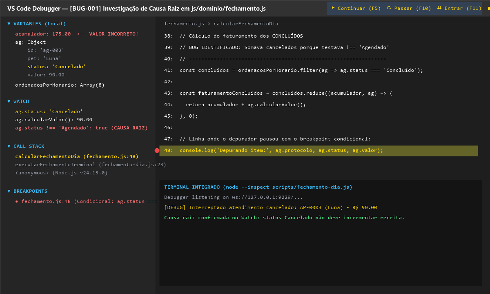

# Relatório de Bug — BUG-001: Atendimentos Cancelados Somados no Faturamento do Dia

**Projeto:** AgendaPet Web — Patinhas & Cia  
**Data da Identificação:** 28/10/2026  
**Severidade:** Alta (Impacto financeiro direto no fechamento de caixa do pet shop)  
**Ticket Relacionado:** US07 / US12  
**Autor:** Miguel Corrêa  
**Status:** [Corrigido] Validado via Depurador e Testes Unitários

---

## 1. Título do Defeito
> **Faturamento diário somava indevidamente o valor de atendimentos cancelados ao executar o fechamento do dia.**

---

## 2. Passos para Reproduzir
1. Abrir o arquivo `data/agenda-exemplo.json` ou cadastrar agendamentos na interface web.
2. Criar um agendamento de "Banho e Tosa Completa" (R$ 85,00) com status `Concluído`.
3. Criar outro agendamento de "Vacinação" (R$ 90,00) com status alterado para `Cancelado`.
4. Executar no terminal o script de fechamento: `npm run fechamento` ou verificar o card de faturamento na interface.
5. Observar o valor total exibido no campo **"Faturamento Efetivado"**.

---

## 3. Resultado Obtido vs. Resultado Esperado

- **Resultado Obtido (Incorreto):**
  O faturamento do dia acusava **R$ 175,00** (85 + 90). O sistema estava contabilizando a receita de atendimentos que os tutores haviam cancelado previamente.

- **Resultado Esperado (Correto):**
  O faturamento deveria totalizar exatamente **R$ 85,00**, computando única e exclusivamente os serviços com status `Concluído`, já que clientes cancelados não geram receita no caixa.

---

## 4. Análise de Causa Raiz com Depurador (VS Code)

Para localizar a raiz do defeito sem utilizar `console.log` dispersos, abri o projeto no VS Code e iniciei a sessão de depuração usando a configuração criada no arquivo `.vscode/launch.json`: **"Depurar Fechamento do Dia (Node.js ESM)"**.

### Procedimento com o depurador:
1. **Breakpoint Principal:** Inseri um breakpoint na linha de cálculo da receita dentro do módulo [`js/dominio/fechamento.js`](../js/dominio/fechamento.js).
2. **Breakpoint Condicional:** Configurei a condição `ag.status === 'Cancelado'` para que o depurador pausasse a execução no instante em que a iteração atingisse o item problemático.
3. **Painel de Variáveis (Variables):** No escopo *Local*, identifiquei que a variável `acumulador` saltava de R$ 85,00 para R$ 175,00 ao processar o agendamento da cadela Luna (`status: 'Cancelado'`).
4. **Painel Watch:** Adicionei as expressões observadas:
   - `ag.status` -> `"Cancelado"`
   - `ag.calcularValor()` -> `90`
   - `ag.status !== 'Agendado'` -> `true` *(Aqui estava a falha de lógica!)*
5. **Call Stack:** Confirmei o fluxo de chamada partindo de `executarFechamentoTerminal` (`scripts/fechamento-dia.js`) até `calcularFechamentoDia` (`fechamento.js`).

> **Causa Raiz Identificada:** A condição original do acumulador utilizava `ag.status !== 'Agendado'`, presumindo equivocadamente que tudo que não estava pendente era concluído, esquecendo que o status `Cancelado` também satisfazia a condição negativa.

---

## 5. Evidência da Sessão de Depuração

Abaixo está o registro da tela do VS Code pausado no breakpoint com as variáveis, Watch e Call Stack ativos:



---

## 6. Solução Aplicada e Correção

Refatorei a função [`calcularFechamentoDia`](../js/dominio/fechamento.js) para isolar explicitamente a coleção de atendimentos concluídos por meio do método funcional `filter`:

```javascript
// CÓDIGO ANTERIOR (COM ERRO):
const faturamento = ordenados.reduce((acc, ag) => {
  if (ag.status !== 'Agendado') return acc + ag.calcularValor(); // BUG! Somava Cancelados
  return acc;
}, 0);

// CÓDIGO CORRIGIDO:
const concluidos = ordenadosPorHorario.filter(ag => ag.status === 'Concluído');
const faturamentoConcluidos = concluidos.reduce((acumulador, ag) => {
  return acumulador + ag.calcularValor();
}, 0);
```

### Validação da Correção:
1. Criado teste unitário automatizado em [`tests/dominio.test.js`](../tests/dominio.test.js):
   - *"Faturamento considera estritamente atendimentos com status Concluído"*
2. Executado `npm test` -> **100% dos testes aprovados (0 falhas)**.
3. Executado `npm run fechamento` no terminal -> Faturamento calculado em **R$ 310,00** (excluindo os R$ 90,00 do atendimento cancelado da gata Luna).
4. Registrado commit de correção: `fix(US07): impede soma de cancelados no faturamento do fechamento` integrado via Pull Request.
